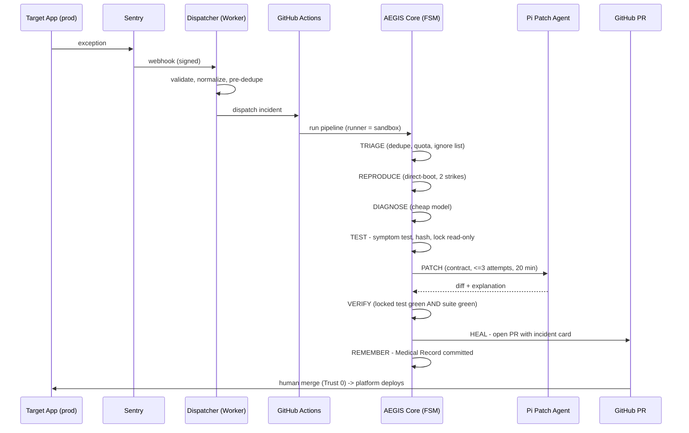
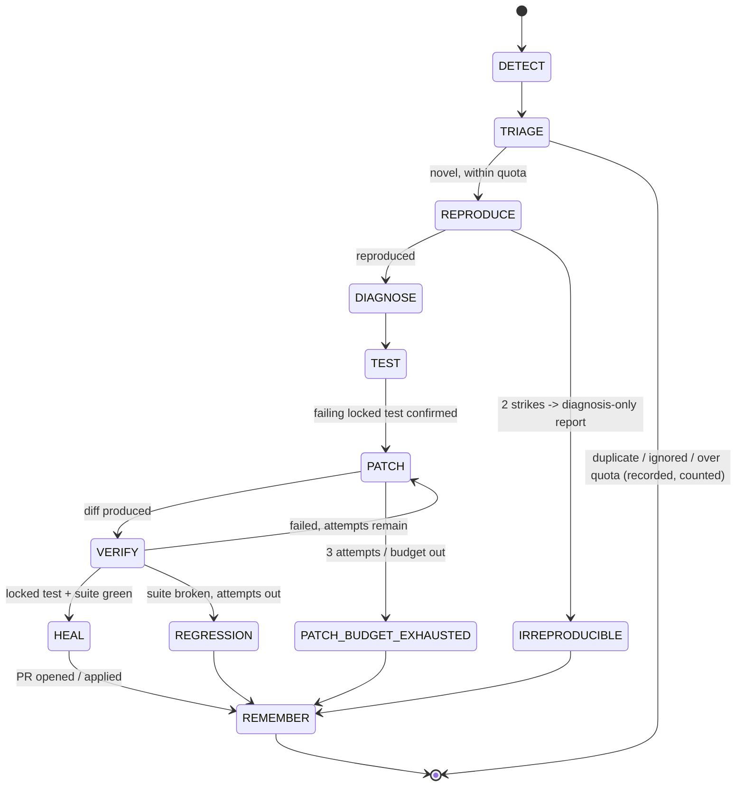
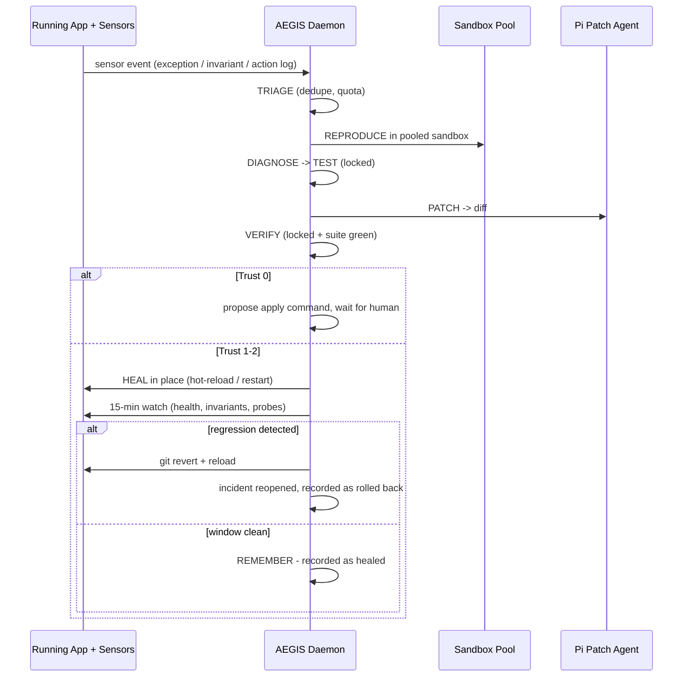
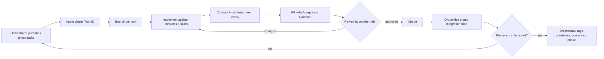
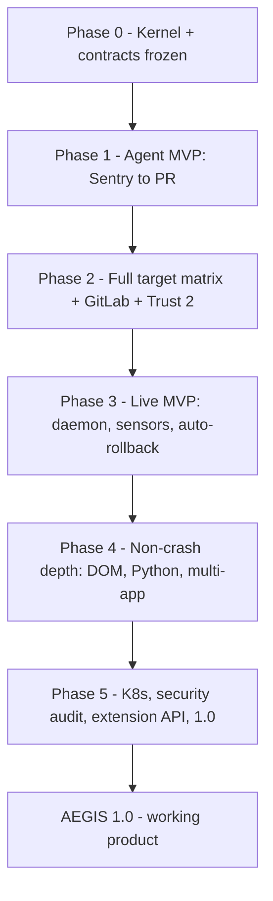

# AEGIS — Complete Execution Flow

> **Source plan:** `aegis-project-plan.md` (master plan, in this folder)
> **Purpose of this document:** The single handoff document a group of
> implementing agents (and any human lead) uses to build AEGIS from zero to a
> working product. It contains **no code**. Every open question from the master
> plan is resolved here as a frozen **Decision (D-xx)**. Implementers do not
> re-decide D-xx items; they implement them. Any change to a D-xx item requires
> an ADR (see §13) approved by the Orchestrator.
> **End state:** AEGIS 1.0 — a working product: both editions (Agent + Live),
> full deployment-target matrix, trust ladder, auto-rollback, Medical Record,
> published security audit, and a third-party adapter merged.

---

## 0. How to use this document (agent team — read first)

1. The **Orchestrator** agent owns this document, the task board, and phase
   gates. Only the Orchestrator marks a phase complete.
2. Work is claimed **by Task ID** (§8–§12, e.g. `P0-T03`). One task = one
   owning agent = one branch = one PR. Never two agents on the same task.
3. **Contract-first rule:** Phase 0 contract tasks (P0-T02 → P0-T05) must be
   merged and frozen before any adapter, agent, SDK, or UI implementation
   task starts. Parallel work is only possible because contracts come first.
4. Every task lists: Owner role, Depends-on, Deliverable, Acceptance. A task
   is Done only when its Acceptance is demonstrated, not asserted (see
   Global Definition of Done, §14).
5. If blocked >1 work cycle: file a **Blocker Note** (§13.3) and take the next
   unblocked task. Never improvise around a frozen Decision — escalate.
6. Implementation order inside a phase: contracts → stubs/mocks → real
   implementation → contract tests → integration test → docs for that task.
7. **Definition of "working" at every phase:** the end-to-end vertical slice
   for that phase runs green in CI on a clean machine from the install
   instructions alone. No "works on my machine" merges.

---

## 1. Final product definition (what "done" means at 1.0)

A user with no prior AEGIS knowledge can:

1. Run the init wizard, answer 3 questions (where the app runs, error source,
   trust level), and get a committed config + workflow (Agent edition) — or
   attach the daemon to a running app (Live edition).
2. Have a real production exception detected, triaged, reproduced in a
   sandbox, diagnosed, proven by a locked symptom-derived test, patched by
   the coding agent, verified against the full suite, and healed (PR or
   in-place with rollback window) — with no human touching the pipeline
   except at the trust gate.
3. Open the **Medical Record** for any incident and audit everything: what
   failed, what was diagnosed, the locked test, the diff, every model call
   and its cost, stage timings, the heal, and its rollback outcome.
4. Pause the whole system instantly with the kill switch, set a daily quota
   and token ceiling, and trust that no production secret ever entered a
   sandbox.
5. Do all of the above on any target in the deployment matrix (§5).

---

## 2. Frozen decisions (D-xx) — implement, do not re-decide

| ID | Area | Decision |
|---|---|---|
| D-01 | Language | TypeScript (strict) on Node.js LTS for kernel, adapters, agent-pi, sdk-node, UI server. Target apps remain language-agnostic; only sensor SDKs are per-language (Node/TS first, Python in Phase 4). |
| D-02 | Monorepo | pnpm workspaces + Turborepo. Packages exactly as in master-plan §7: `core`, `adapters/detect`, `adapters/repro`, `adapters/heal`, `agent-pi`, `sdk-node`, `ui`, plus `templates/`, `examples/`, `docs/`. |
| D-03 | Testing | Vitest for unit/contract tests, Playwright for UI/visual and SPA repro. Every adapter ships contract tests against the Phase-0 contract suite. |
| D-04 | Pipeline | Single FSM, 9 stages: DETECT → TRIAGE → SNAPSHOT/REPRODUCE → DIAGNOSE → TEST(lock) → PATCH → VERIFY → HEAL → REMEMBER. Terminal failure states: `IRREPRODUCIBLE`, `PATCH_BUDGET_EXHAUSTED`, `REGRESSION` — all produce a diagnosis-only report marked **unverified**. Never a silent failure. |
| D-05 | Contracts | All cross-package communication uses Phase-0 contracts only: Incident, IncidentSignature, StageInput/StageOutput envelopes, Adapter interfaces, Agent interface, Medical Record entry. No package imports another package's internals. |
| D-06 | Incident store | Local/daemon: SQLite. CI edition: incident state carried as workflow artifacts + committed Medical Record. Store sits behind a repository interface so the backend is swappable. |
| D-07 | Medical Record | Append-only. One entry per incident: (a) machine-readable JSONL record, hash-chained to the previous entry (tamper-evident), and (b) human-readable incident card (Markdown) generated from it. In the target repo it lives under `.aegis/medical-record/` and is committed to git. |
| D-08 | Config | One file: `.aegis/config.yml` in the target repo. Created by the init wizard. Contains: edition, deployment target, error source, repro adapter, heal adapter, trust level, quota, token ceiling, test-suite command override, ignore lists. Schema versioned; invalid config = hard stop with a readable error. |
| D-09 | Dispatcher (Agent MVP) | Cloudflare Worker dispatcher is the single entry for Sentry webhooks: validates signature, normalizes to an Incident, preliminary-dedupes, then dispatches to GitHub Actions. A manual/CLI trigger bypasses the dispatcher for testing. GitLab support (Phase 2) reuses the same dispatcher output contract. |
| D-10 | First error source | Sentry webhook only in Phase 1. GlitchTip and Bugsnag in Phase 2 (same normalized Incident contract). |
| D-11 | First repro target | Direct-boot Node/TS server apps only in Phase 1. All other repro adapters in Phase 2 per the matrix (§5). |
| D-12 | Patch agent | Pi (`@mariozechner/pi-coding-agent`), headless, is the default PATCH implementation behind the pluggable Agent interface (task context in → diff out). Kernel never imports Pi directly; only `agent-pi` does. If Pi's published package name/version has changed at implementation time, Adapter Agent records the actual name in an ADR — the interface does not change. |
| D-13 | Models | Provider-agnostic via Pi's unified LLM API. Two model slots in config: `triage/diagnose` (cheap default) and `patch` (stronger). Keys come only from environment/CI secrets. Per-incident token + cost accounting is mandatory in every incident card. |
| D-14 | Locked test | TEST stage generates a symptom-derived failing test, hashes it, and mounts it read-only for PATCH and VERIFY. The patch agent physically cannot modify it. A heal with a modified/unlocked test is invalid and must be rejected by VERIFY. |
| D-15 | Test-suite detection | Order: (1) explicit command in `.aegis/config.yml`, (2) auto-detect from the target repo (package scripts/manifests), (3) if neither: VERIFY runs the locked test only and the incident card states "full suite not run — not configured". |
| D-16 | Safety defaults | Daily incident quota: **10/day** per repo. Per-run token ceiling: configured, default equivalent of a single incident budget set in config; run aborts to `PATCH_BUDGET_EXHAUSTED`-style escalation on breach. Patch attempts: **≤3**. Patch wall-clock: **20 min**. Sandbox/CI: **no production secrets, ever**. Kill switch: `aegis pause` — checked before every stage; because execution is stateless against a queue, it takes effect on the next stage boundary, i.e. instantly for practical purposes. |
| D-17 | Trust ladder | Level 0 (default): PR only / proposed apply command. Level 1: auto-merge/auto-apply only if suite green **and** diff ≤5 files **and** ≤300 changed lines. Level 2: any green diff. Levels are config; raising a level is a human-only action, never agent-initiated. |
| D-18 | Auto-rollback (Live) | After any in-place heal: 15-minute watch window (health checks + invariants + synthetic probes). Any regression → automatic `git revert` + reload + incident reopened. A heal is recorded as *healed* only after the window passes clean. |
| D-19 | Repro fallback | An adapter gets 2 attempts to reproduce. Then the incident falls back to diagnosis-only mode (report marked unverified) instead of failing. Adapter health is tracked per target type. |
| D-20 | Dedup / noise | TRIAGE fingerprints incidents by normalized signature (error type + top frames + route). Same signature within the quota window = one incident, occurrence count incremented. Ignore lists from config are applied before quota. |
| D-21 | Prompt-injection defense | Stack traces, logs, and app output are **untrusted data**: quarantined (clearly delimited, never interpreted as instructions) in every prompt; sandboxed execution; no secrets in the sandbox; outgoing diff always passes the VERIFY gates regardless of trust level. |
| D-22 | Example apps | One seeded-bug example app per deployment target, kept in `examples/`. Each has: a known crash, a known non-crash failure (from Phase 4), and a passing suite. These are the canonical integration fixtures. |
| D-23 | Releases/versioning | Semver. Packages versioned together until 1.0. Every phase exit = a tagged prerelease. Changelog generated from Medical-Record-style commit discipline: every merge states what/why/verification. |
| D-24 | License/hosting | Open-source core, public GitHub repo, OSI-approved permissive license chosen by Orchestrator in Phase 0 and recorded in ADR-001. |
| D-25 | Deliverable language | All docs, incident cards, and UI text in English. Incident cards must be readable by a non-expert app owner. |

---

## 3. Agent team — roles and ownership

The implementing team is a **group of agents**. Roles are exclusive by
package to prevent merge conflicts and contract drift.

| Role | Owns | Never touches |
|---|---|---|
| **Orchestrator** | This doc, task board, phase gates, ADRs, releases | Feature implementation |
| **Core Agent** | `packages/core` (FSM, contracts, incident store, Medical Record, safety rails, CLI) | Adapter internals, Pi internals |
| **Adapter Agent** | `packages/adapters/**` (detect, repro, heal) | Core contracts (requests changes via ADR) |
| **Patch-Agent Integrator** | `packages/agent-pi` (Pi integration, patch contract/prompt, attempt loop) | FSM, heal adapters |
| **SDK Agent** | `packages/sdk-node` (Phase 3), `sdk-python` (Phase 4) | Daemon internals |
| **UI Agent** | `packages/ui` (Live dashboard, Medical Record viewer, incident cards rendering) | Pipeline logic |
| **QA/Verification Agent** | Contract test suites, integration/e2e tests, `examples/` seeded apps, phase-exit evidence | Feature code under test (files bugs as tasks instead) |
| **Security Agent** | Threat model, sandbox/secret review, prompt-injection tests, Phase-5 audit | Feature code (files findings as tasks) |
| **Docs/DevEx Agent** | `docs/`, `templates/`, install UX, README, changelog | Runtime behavior |

Rules for all agents:

- Claim a task → set it In Progress on the board with your role name.
- PR must reference Task ID, list Decisions touched (normally none), and
  attach Acceptance evidence (test output summary, incident card, or drill log).
- Every PR is reviewed by a **different** agent role than the author.
  QA Agent reviews all phase-exit PRs. Security Agent reviews anything
  touching sandbox, secrets, prompts, or heal execution.
- Contract changes after Phase-0 freeze require an ADR + Core Agent +
  Orchestrator approval + contract-test updates in the same PR.

---

## 4. Core contracts to freeze in Phase 0 (content, not code)

These are specified in Phase 0 as written interface descriptions + field
lists + contract tests. Everything later is built against them.

### 4.1 Incident
Fields: id, signature (fingerprint), source (adapter id), edition, repo/app
identity, first-seen and last-seen timestamps, occurrence count, status
(FSM state), severity, raw evidence references (stack trace, logs, action
log, screenshot refs), environment snapshot ref, diagnosis (nullable),
locked-test ref + hash (nullable), patch attempts, diff refs, verification
results, heal result, rollback result, token/cost totals, stage timings,
trust level applied, links to Medical Record entry.

### 4.2 Stage envelope
Every stage receives: incident id, config snapshot, inputs-by-reference
(artifacts from prior stages), budget remaining (time + tokens), kill-switch
check result. Every stage returns: outcome (advance / terminal-state /
retry), artifacts produced, timing, cost, human-readable stage summary for
the incident card. Stages are idempotent: re-running a stage with the same
inputs must not duplicate external effects (PRs, applies, record entries).

### 4.3 Adapter interfaces
- **Detect adapter:** emits normalized Incidents; declares its source type;
  supports a health check; never writes to the store directly.
- **Repro adapter:** given an Incident + repo, returns a runnable sandbox
  session or a failure reason; declares which deployment targets it supports;
  enforces the 2-strike rule (D-19).
- **Heal adapter:** given a verified diff, performs the heal and returns a
  rollback plan + rollback executor. No heal without a rollback path.
- **Patch agent interface:** given task context (incident, diagnosis, locked
  test location, repo map, patch contract), returns a diff or a failure
  reason. Attempt counting and budget enforcement live in Core, not the agent.

### 4.4 Patch contract (given to the coding agent on every PATCH run)
Minimal diff only. Locked tests are read-only. Existing tests must not be
weakened or deleted. No new dependencies unless the diagnosis requires it
(and then it must be justified in the stage summary). ≤3 attempts, 20-minute
wall clock (D-16). Output is a diff + a plain-English explanation of the
root cause and the fix.

### 4.5 Medical Record entry
Generated at REMEMBER and on every terminal failure. Contains: full Incident
summary, stage-by-stage timeline with timings and costs, diagnosis, locked
test identity + hash, final diff, verification evidence, heal/rollback
outcome, trust level, and the hash-chain link to the previous entry (D-07).

---

## 5. Deployment-target matrix (acceptance reference for Phase 2/5)

| App deployment | Detection | Repro adapter | Heal path |
|---|---|---|---|
| VM / dedicated (long-running) | Sensors (best) or webhook | Direct-boot in sandbox with fixture DB | Hot-reload / process-manager restart (systemd, pm2) / PR |
| Docker / compose | Sensors or webhook | Compose project in sandbox | Rolling container replace / PR |
| Kubernetes *(Phase 5)* | Sensors or webhook | K8s Job sandbox | Rolling deploy / PR |
| PaaS (Railway/Render/Fly) | Webhook | Direct-boot or platform image | PR → git deploy |
| Serverless (Vercel/Netlify/Lambda) | Webhook | Platform CLI dev mode | PR → git deploy |
| Cloudflare Workers/Pages | Webhook / logpush | `wrangler dev` (miniflare, local bindings) | PR → CI deploy |
| Static SPA + API | API webhook + DOM sensors (Phase 4) | Playwright (SPA) + API adapter | PR → platform deploy |

AEGIS itself: Agent edition runs on GitHub Actions (Phase 1), GitLab CI
(Phase 2). Live edition runs beside the app: same VM (recommended), separate
machine, compose bundle, or PaaS worker. **AEGIS never runs inside the app's
runtime.**

---

## 6. End-to-end flows

### 6.1 Agent edition (CI) — happy path

### 6.2 Pipeline FSM (both editions)

Every transition checks: kill switch (D-16), token ceiling, stage timeout.
A pause or budget breach stops at the next stage boundary and is recorded.

### 6.3 Live edition — in-place heal + auto-rollback

### 6.4 Failure / escalation flow (all editions)
Any terminal state (`IRREPRODUCIBLE`, `PATCH_BUDGET_EXHAUSTED`,
`REGRESSION`, budget breach, repro fallback) produces: diagnosis-only
report marked **unverified**, full evidence attached, Medical Record entry,
and a notification in the same channel a PR would have used. Nothing fails
silently; nothing unverified is ever healed.

### 6.5 Install flows
- **Agent:** init wizard asks 3 questions → writes `.aegis/config.yml` +
  `.github/workflows/aegis.yml` (or GitLab equivalent, Phase 2) → first-run
  self-test incident (synthetic) proves the wiring → reports ready.
- **Live:** installer (shell installer or compose bundle) → `aegis attach`
  instruments the app with the sensor SDK → daemon health check → synthetic
  seeded fault proves detect→report (no auto-heal until trust is set).

---

## 7. Work management flow for the agent group

Board states: `Backlog → Ready → In Progress → In Review → Done`, plus
`Blocked` (requires a Blocker Note, §13.3). A phase's tasks move to Ready
only when their Depends-on tasks are Done.

---

## 8. Phase 0 — Kernel foundations

**Goal:** an incident flows end-to-end through the FSM with a stub agent.
**Agents:** Core (lead), QA, Docs, Security (review only).

| ID | Task | Owner | Depends | Deliverable | Acceptance |
|---|---|---|---|---|---|
| P0-T01 | Repo bootstrap: monorepo (D-02), CI for AEGIS itself, lint/format/typecheck, license ADR-001 (D-24) | Core | — | Runnable empty monorepo, green CI | Clean-clone setup documented by Docs agent works without help |
| P0-T02 | Incident + Signature contract (§4.1) incl. fingerprinting rules (D-20) | Core | T01 | Written contract + contract tests | QA contract tests pass; two sample stack traces produce stable, distinct signatures as specified |
| P0-T03 | Stage envelope + FSM (§4.2, D-04) incl. terminal states, idempotency, kill-switch/budget checks per transition | Core | T02 | FSM implementation with stub stages | Incident traverses all 9 stages and each terminal state in tests |
| P0-T04 | Adapter + Patch-agent interfaces (§4.3–4.4) with stub implementations (fake detect/repro/heal/agent) | Core | T03 | Interfaces + stubs | Vertical slice runs on stubs (Phase-0 exit demo) |
| P0-T05 | Medical Record format + hash chain (§4.5, D-07) + incident-card renderer spec | Core | T02 | Record writer + sample card | Tampering with a sample entry is detected by the verifier test |
| P0-T06 | Incident store: SQLite + repository interface (D-06) | Core | T02 | Store + tests | Store round-trips a full Incident; backend swap point documented |
| P0-T07 | Config schema `.aegis/config.yml` (D-08) + validation errors | Core | T01 | Schema + validator + sample configs per edition | Invalid configs fail with readable messages in tests |
| P0-T08 | CLI skeleton: `init`, `run`, `pause`, `status` command structure (behavior stubbed where later phases own it) | Core | T03, T07 | CLI skeleton | `pause` demonstrably halts a stub run at the next stage boundary |
| P0-T09 | Safety rails in Core: quota, token ceiling accounting, attempt/budget enforcement points (D-16) | Core | T03 | Rails + tests | Simulated over-quota and over-budget runs stop and record correctly |
| P0-T10 | Hardening of design refs into `docs/`: architecture, contracts, trust ladder, threat-model v1 (D-21) | Docs + Security | T02–T05 | Docs set | Security agent approves threat model v1 |

**Phase 0 exit (Orchestrator-verified):** scripted demo — a fake incident
flows DETECT→REMEMBER on stubs, produces a valid Medical Record entry and
incident card, respects pause and quota. Tag prerelease.

---

## 9. Phase 1 — AEGIS Agent MVP

**Goal:** Sentry exception → PR with incident card, on real repos.
**Agents:** Adapter (lead), Patch-Agent Integrator, Core, QA, Docs.

| ID | Task | Owner | Depends | Deliverable | Acceptance |
|---|---|---|---|---|---|
| P1-T01 | Dispatcher Worker (D-09): Sentry signature validation, normalization to Incident, pre-dedupe, dispatch to GitHub Actions, manual-trigger bypass | Adapter | P0-T02 | Deployed-testable dispatcher | Forged/unsigned webhooks rejected; valid webhook yields exactly one dispatch |
| P1-T02 | Sentry detect adapter (in-CI side): consumes dispatched Incident into the FSM | Adapter | P0-T04 | Detect adapter + contract tests | Contract suite green |
| P1-T03 | `workflow-github` template: one-file install, secrets documented (model keys only), runner hardening (no prod secrets) | Docs + Adapter | T01 | Template in `templates/` | Fresh test repo installs from template alone |
| P1-T04 | Direct-boot repro adapter (Node/TS server apps, fixture DB support) (D-11, D-19) | Adapter | P0-T04 | Repro adapter + contract tests | Reproduces the seeded crash in `examples/vm-app`; 2-strike fallback demonstrated |
| P1-T05 | Pi integration: headless invocation, patch-contract delivery, diff capture, attempt loop wired to Core budgets (D-12–D-14) | Patch-Agent Integrator | P0-T04 | `agent-pi` package | Stub-repo bug patched within contract; locked test untouched (hash verified) |
| P1-T06 | Diagnose stage (real model call): stack + repo map + repro transcript → structured diagnosis; cost recorded (D-13) | Core + Integrator | T04 | Real DIAGNOSE | Diagnosis for seeded bug identifies true root cause; cost in card |
| P1-T07 | TEST stage (real): symptom-derived failing test generation, hash + read-only lock (D-14) | Core | T06 | Locked-test mechanism | Test fails pre-patch, passes post-patch; agent attempt to edit it fails physically |
| P1-T08 | VERIFY stage: locked test + suite per D-15, regression classification | Core | T07 | Verify gate | Seeded good patch passes; seeded regressive patch classified `REGRESSION` |
| P1-T09 | PR heal adapter: branch, commit (fix + Medical Record), PR with incident card (diagnosis, diff summary, costs, timings, trust level) | Adapter | T08 | PR heal adapter | PR on test repo contains complete, readable card |
| P1-T10 | Init wizard (Agent path): 3 questions → config + workflow commit → synthetic self-test incident (§6.5) | Core + Docs | T03, P0-T07/T08 | Working `aegis init` | New user path completed by QA from docs only |
| P1-T11 | Trust levels 0–1 enforcement (D-17): PR-only; auto-merge gate (suite green + ≤5 files + ≤300 lines) | Core | T09 | Trust gate | Oversized green diff at L1 does **not** auto-merge; compliant diff does |
| P1-T12 | Example app `examples/vm-app` (D-22): seeded real crash + passing suite | QA | T04 | Example app | Crash reproducible, suite green pre-seed |
| P1-T13 | External validation: run against 3 real external repos (Node/TS servers) | QA + Orchestrator | T01–T12 | Evidence pack | **Phase-1 exit:** each repo — real exception → PR ≤15 min, suite green, one merged heal per repo |

**Phase 1 exit:** P1-T13 evidence + metrics baseline (time-to-PR, cost per
incident) recorded in `docs/`. Tag prerelease.

---

## 10. Phase 2 — Coverage (full matrix except K8s)

**Goal:** every row of §5 except Kubernetes green in integration tests.
**Agents:** Adapter (lead), Core, QA, Docs.

| ID | Task | Owner | Depends | Deliverable | Acceptance |
|---|---|---|---|---|---|
| P2-T01 | Repro adapters: docker-compose, PaaS image/direct-boot variants | Adapter | Phase 1 | Adapters + contract tests | Seeded crash reproduced per target in CI |
| P2-T02 | Repro adapters: Vercel/Netlify functions (platform CLI dev mode) | Adapter | T01 | Adapters | Seeded function error reproduced locally |
| P2-T03 | Repro adapter: Cloudflare Workers via wrangler/miniflare local bindings | Adapter | T01 | Adapter | Seeded Worker error reproduced with local bindings only |
| P2-T04 | Detect adapters: GlitchTip, Bugsnag, generic log-scraper, Workers logpush | Adapter | Phase 1 | Adapters (D-10 complete) | Each source yields normalized Incidents passing contract tests |
| P2-T05 | GitLab CI edition: template + dispatcher target | Adapter + Docs | T04 | GitLab template | Full Agent flow green on a GitLab test repo |
| P2-T06 | Heal adapters: PR→git-deploy verification for PaaS/serverless/Workers (confirm platform deploy after merge; report deploy outcome in card) | Adapter | T01–T03 | Heal verification | Merged heal's deployment outcome recorded, failures escalated |
| P2-T07 | Trust level 2 (D-17) + quota/budget dashboards surfaced in incident cards | Core | Phase 1 | L2 gate + card upgrade | L2 auto-merge demonstrated; card shows quota/budget state |
| P2-T08 | Diagnosis-only mode polish: report quality bar, unverified labeling everywhere, repro-health per adapter (D-19) | Core + Docs | T01–T04 | Polished fallback | Forced-irreproducible incident yields a report a human can act on (QA-reviewed) |
| P2-T09 | Example apps per target (functions, worker, compose, PaaS) (D-22) + matrix integration suite | QA | T01–T06 | `examples/` complete for §5 (excl. K8s) | **Phase-2 exit:** matrix suite fully green in CI |

**Phase 2 exit:** P2-T09 green; heal-rate metric reported against §15 targets.

---

## 11. Phase 3 — AEGIS Live MVP

**Goal:** seeded failure heals in place on a running VM app, session intact,
with a passing rollback drill.
**Agents:** SDK (lead), Core, Adapter, UI, QA.

| ID | Task | Owner | Depends | Deliverable | Acceptance |
|---|---|---|---|---|---|
| P3-T01 | Daemon skeleton: always-on process, ingest queue, stateless stage execution against queue, `pause` honored instantly (D-16) | Core | Phase 1 | Daemon | Daemon survives restart mid-incident without duplicate effects |
| P3-T02 | Node sensor SDK: exception hook, invariant checks API, action log (ring buffer, privacy-safe defaults) | SDK | P0 contracts | `sdk-node` | Sensors emit events for crash + invariant breach in example app |
| P3-T03 | Sensors-ingest detect adapter (daemon-side) | Adapter | T01, T02 | Adapter | Sensor events become Incidents via the same TRIAGE as webhooks |
| P3-T04 | Sandbox pool: pre-warmed direct-boot sandboxes, isolation, no-secrets enforcement, fixture DB | Adapter + Security | T01 | Pool | Pool reuses sandboxes safely; Security approves isolation tests |
| P3-T05 | In-place heal adapters: hot-reload, process-manager restart (systemd, pm2), each with rollback executor (§4.3) | Adapter | T04 | Heal adapters | Heal applied and rolled back on demand in test VM app |
| P3-T06 | Auto-rollback watch (D-18): 15-min window, health/invariant/probe checks, auto `git revert` + reload + reopen | Core | T05 | Rollback engine | **Rollback drill:** regression injected post-heal → auto-revert fires, incident reopened, record correct |
| P3-T07 | Trust ladder for Live (D-17): L0 proposed-apply, L1 auto-apply under diff limits, L2 full | Core | T06 | Live trust gate | L0 never applies without human confirmation (tested) |
| P3-T08 | Live UI v1: pipeline status per incident, incident list, Medical Record view, pause control | UI | T01, P0-T05 | Dashboard | Operator can watch a heal live and pause from UI |
| P3-T09 | `aegis attach` + Live install (installer + compose bundle) (§6.5) | Docs + SDK | T02, T08 | Install path | QA attaches to a fresh VM app from docs only |
| P3-T10 | Live end-to-end validation on `examples/vm-app` running under pm2 and systemd | QA | T01–T09 | Evidence pack | **Phase-3 exit:** seeded failure healed in place, user session intact, rollback drill (T06) passing |

---

## 12. Phase 4 — Depth, and Phase 5 — 1.0 & scale

### Phase 4 — Depth
**Agents:** SDK (lead), UI, Adapter, QA.

| ID | Task | Owner | Depends | Acceptance |
|---|---|---|---|---|
| P4-T01 | DOM observer sensor: client-side state/error capture for SPA targets | SDK | Phase 3 | Bad-state (HTTP 200) failure captured in SPA example |
| P4-T02 | Screenshot/visual-diff module in VERIFY (optional per config) | UI + Core | T01 | Visual regression on seeded glitch detected; non-visual incidents unaffected |
| P4-T03 | Python sensor SDK (exception hook + invariants, same event contract) | SDK | P3-T02 contract | Python example app incidents flow through the daemon unchanged |
| P4-T04 | Docker rolling-replace heal adapter | Adapter | P2-T01 | Container heal with rollback demonstrated |
| P4-T05 | Medical Record viewer as first-class UI: search, filter, cost/timing analytics per app | UI | P3-T08 | Owner can audit any historical heal in ≤3 clicks |
| P4-T06 | Multi-app daemon: one daemon, many attached apps, per-app config/quota/trust | Core | Phase 3 | Two apps healed independently; quotas isolated |
| P4-T07 | Non-crash end-to-end proof | QA | T01–T04 | **Phase-4 exit:** a bad-state HTTP-200 failure healed live — detected, locked-test proven, patched, verified, recorded |

### Phase 5 — 1.0 and scale
**Agents:** Adapter, Security (lead for audit), Core, Docs, Orchestrator.

| ID | Task | Owner | Depends | Acceptance |
|---|---|---|---|---|
| P5-T01 | Kubernetes target: K8s Job sandbox repro + rolling-deploy heal | Adapter | Phase 4 | §5 matrix now 100% green incl. K8s row |
| P5-T02 | Hardened security review: sandbox escape attempts, secret-handling audit, prompt-injection red-team suite (D-21) | Security | All prior | Findings fixed or formally accepted by Orchestrator; suite in CI |
| P5-T03 | Extension API: documented adapter + patch-agent plugin points, conformance contract-test kit for third parties | Core + Docs | P5-T02 | External-style adapter built from docs only passes conformance kit |
| P5-T04 | Hosted-dispatcher option (managed alternative to self-hosted Worker) | Adapter | P5-T03 | Opt-in hosted path passes the same integration suite |
| P5-T05 | Opt-in usage telemetry (anonymous, off by default, documented data list) | Core | P5-T02 | Telemetry off = zero calls (verified); on = only documented fields |
| P5-T06 | 1.0 release: full-matrix regression, install-from-scratch gauntlet on every target, docs freeze | QA + Orchestrator | T01–T05 | Clean-machine installs pass on all §5 targets |
| P5-T07 | Publish security audit + invite/merge first third-party adapter | Orchestrator | T02, T03 | **1.0 exit:** 1.0 tagged, audit published, third-party adapter merged |

---

## 13. Cross-cutting rules

### 13.1 Testing strategy (QA Agent owns)
- **Unit** per package; **contract tests** for every adapter/agent against
  Phase-0 contracts (a new adapter is not Done without them); **integration**
  per deployment target using `examples/` seeded apps; **e2e**: one Agent-edition
  and one Live-edition golden path in CI on every merge to main.
- Flaky test = bug task against its owner; quarantining a test requires
  Orchestrator approval and an expiry date.

### 13.2 Security (Security Agent owns)
- Threat model updated every phase. Standing rules: no production secrets in
  any sandbox/runner; all app-derived text is untrusted in prompts (D-21);
  heal execution requires a rollback path; diff gates apply at every trust
  level. Any violation found in review blocks merge.

### 13.3 Blockers and decisions during implementation
- **Blocker Note** (filed on the board, linked from the task): what is
  blocked, what was tried, what is needed, suggested next task taken instead.
- **ADR** required for: any D-xx change, any contract change, any new
  external dependency of `core`. ADRs are numbered, dated, one page, stored
  in `docs/adr/`, approved by Orchestrator (+ Core for contracts, +
  Security for trust/sandbox/secrets topics).

### 13.4 Documentation (Docs Agent owns)
Every merged task updates its user-facing docs in the same PR if it changes
install, config, trust, or incident-card behavior. README quickstart is
re-validated from scratch at every phase exit.

---

## 14. Global Definition of Done (every task)

A task is Done only when **all** hold:

1. Deliverable merged via reviewed PR referencing the Task ID.
2. Its Acceptance is demonstrated with attached evidence (test results,
   incident card, drill log, or QA sign-off) — not merely claimed.
3. Contract + relevant integration tests green in CI.
4. No D-xx decision violated; any ADR it required is merged.
5. Docs/config-schema/incident-card impacts updated in the same PR.
6. No secrets, no production data, no weakened tests introduced.

---

## 15. Success metrics (measured from Phase 1, reported per phase)

| Metric | Definition | Target |
|---|---|---|
| Heal rate | Healed-and-merged ÷ triaged incidents | ≥50% by Phase 2 |
| Time-to-PR / time-to-heal | Median exception → PR (Agent); exception → verified live heal (Live) | ≤15 min Agent (Phase 1); report Live from Phase 3 |
| Regression escape rate | Healed PRs later reverted or causing new incidents | <2% |
| Trust adoption | Share of installs per trust level over time | Report only |
| Cost per heal | Median tokens + compute per healed incident | Report per phase; investigate top decile |
| Rollback success | Auto-rollbacks that restored health ÷ auto-rollbacks fired | 100% (any failure = P1 bug) |

Metrics come from Medical Record data (stage timings, costs, outcomes) —
no separate analytics pipeline is built before Phase 5 telemetry (opt-in).

---

## 16. Risks → built-in mitigations (already in the flow)

| Risk | Where handled |
|---|---|
| Agent games the test | D-14 locked read-only test; P0/P1-T07 hash verification |
| PR/incident spam | D-20 fingerprint dedupe + D-16 quota in TRIAGE (P0-T09) |
| Bad patch reaches users | Trust ladder D-17, VERIFY gates, D-18 auto-rollback (P3-T06) |
| Prompt injection via traces/logs | D-21 quarantine; P5-T02 red-team suite |
| Flaky repro across targets | D-19 2-strike diagnosis-only fallback; P2-T08 repro health |
| Model cost runaway | D-16 ceilings; per-incident accounting D-13; cheapest model for triage/diagnose |
| "Another AIOps tool" skepticism | Medical Record is default-public proof (D-07); every heal auditable in git |

---

## 17. Execution sequence at a glance

**First actions for the team (Day 1):**
1. Orchestrator creates the board from Task IDs in §8–§12 and publishes this
   document + the master plan to the repo `docs/`.
2. Core Agent starts **P0-T01**; Docs Agent drafts ADR-001 (license, D-24)
   and the docs skeleton (P0-T10 inputs).
3. QA Agent defines the contract-test harness shape needed by P0-T02–T04.
4. No other implementation starts until Phase-0 contracts freeze (§0.3).

*End of execution flow. Implementers: claim a Task ID and begin.*
